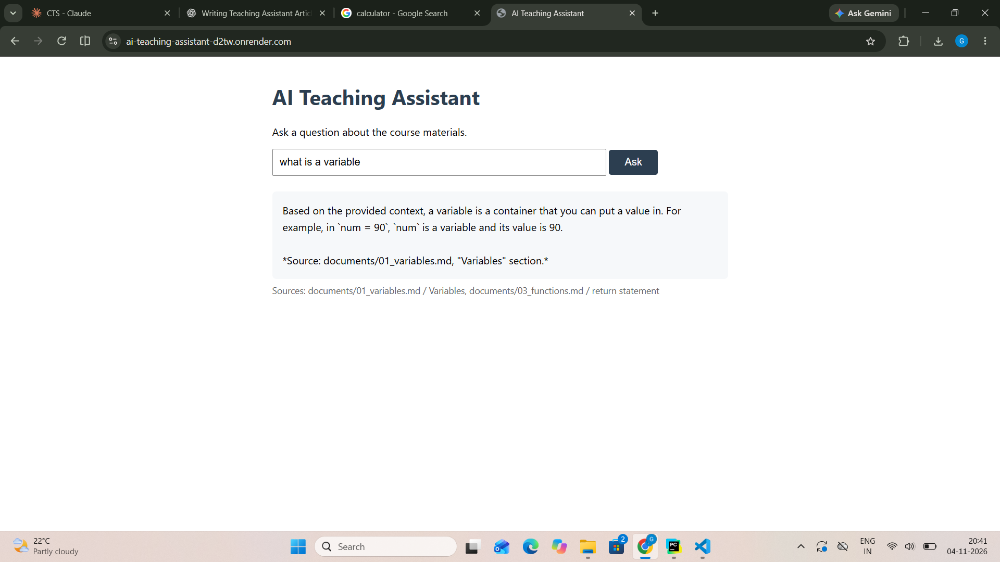

# AI Teaching Assistant
**Live demo:** https://ai-teaching-assistant-d2tw.onrender.com/
*(Free-tier hosting — first request after idle takes ~50s to wake.)*




## What it is
A RAG assistant that answers questions about my self-authored Python teaching 
docs, with citations, and refuses out-of-scope questions. Being a coding 
teacher, I have been teaching Python for many years, so I wrote the three 
course documents myself (variables, loops, functions) instead of scraping 
someone else's content.

## Architecture

```text
INGESTION (one-time, python store.py)
documents/*.md → chunker → Voyage (embed) → Supabase Postgres + pgvector

QUERY (every request)
browser → FastAPI /ask → Voyage (embed question)
        → pgvector: top-3 nearest chunks (cosine <=>)
        → threshold 0.93 (aliens refused before any LLM call)
        → Claude (answer ONLY from chunks, with citations)
        → JSON { answer, sources } → browser
```

### This system has two journeys:
**Journey 1** — All the documents go through a chunker, which splits them into chunks. These chunks are given to Voyage AI, which converts each one into a 1024-number vector (embedding). The chunks and their vectors are stored in Postgres — the pgvector extension is what lets Postgres hold and compare vectors.


**Journey 2** — User types a question; the question is converted into an embedding using the Voyage API. pgvector finds the 3 chunks nearest to the question’s embedding. If even the nearest chunk is farther than 0.93, the app refuses immediately — this check runs before Claude, so out-of-scope questions cost no LLM tokens. Otherwise the chunks and the question go to Claude, which answers ONLY from those chunks, with citations, and that answer plus its sources is what the user gets back.


## Tech stack
Python, FastAPI, PostgreSQL + pgvector, Voyage AI, Anthropic Claude, Render + Supabase

## Run it locally

```bash
git clone https://github.com/Gunjan-redu/ai-teaching-assistant.git
cd ai-teaching-assistant
python -m venv venv
venv\Scripts\activate        # Windows (source venv/bin/activate on Mac/Linux)
pip install -r requirements.txt
```

Copy `.env.example` to `.env` and fill in your own keys
(Anthropic, Voyage) and Postgres credentials.

You need a Postgres with the pgvector extension — easiest via Docker:

```bash
docker run -d --name rag-db -p 5433:5432 -e POSTGRES_PASSWORD=secret pgvector/pgvector:pg16
```

Create the table (run `schema.sql` against the database), then:

```bash
python store.py        # chunk + embed + store the documents
uvicorn main:app --reload
```

Open http://127.0.0.1:8000 — ask away.

To run the tests (fully mocked, no API calls needed):

```bash
pytest -v
```

## Tests
The project uses pytest for automated testing. All external APIs (Voyage, 
Claude) are mocked, so the whole suite runs offline in about a second — 
no API keys or tokens needed.

What's covered:
- the full /ask pipeline returns an answer with sources (both APIs faked)
- out-of-scope questions get refused with empty sources
- a missing question body returns 422
- retrieval returns properly shaped chunks from a fake embedding
- VoyageAI's rate-limit error is caught and returned as a clean 429

## What I learned

- **The RAG pipeline end to end** — documents get chunked, chunks get turned 
  into 1024-number vectors by Voyage AI, and the question goes through the 
  same process. The vectors are only for *finding* the right chunks; Claude 
  never sees them — it reads the chunks' text and answers only from that.

- **Working with LLM APIs** — I had never used an API key from an LLM 
  before. Using Claude's API (and Voyage's) was completely new to me.

- **pgvector** — I didn't know a database could store 1024-dimensional 
  vectors as a column type and search them by distance in plain SQL. 
  That was new to me.

- **A distance threshold can't judge relevance** *(my measurement)* — a 
  question my docs covered scored 0.853 and one they didn't cover scored 
  0.852: indistinguishable. The threshold (0.93) only catches completely 
  unrelated questions; for everything else, only Claude reading the actual 
  chunks can decide. 

- **My assistant audited my own teaching** — it flagged that my functions 
  doc never actually defined what a function is. I enriched the doc, 
  re-ingested, and the answers transformed. 

- **Testing, honestly** — I was familiar with testing, but it wasn't 
  clicking. It still hasn't clicked fully, but I understand it much better 
  now — especially why we mock: you can't test a rate-limit error by 
  waiting for one, and my own test suite rate-limited itself until every 
  external API was faked. 

- **"Works on my machine," literally** — I wrote `DB_Port` instead of 
  `DB_PORT`. Windows didn't care for weeks; Linux killed the first deploy 
  with it. Environment variables are case-sensitive on Linux. 

- **Deployment** — connecting the project to Supabase (the cloud Postgres) 
  and deploying on Render. One .env swap pointed the same code at a 
  database in Tokyo — config over code.
